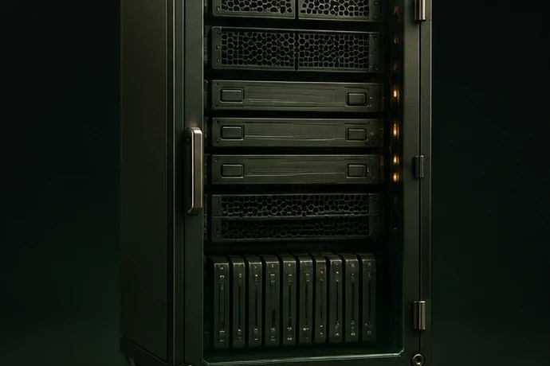
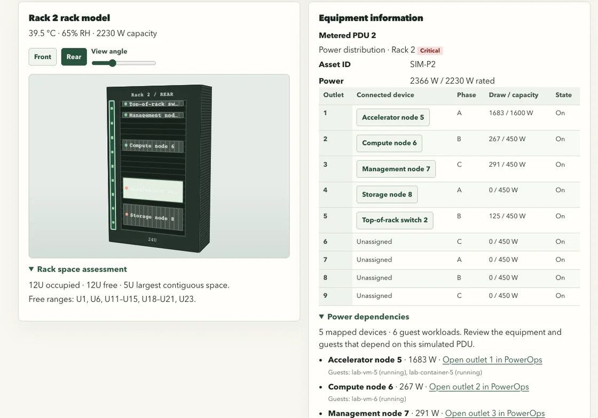
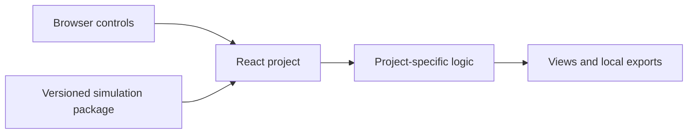

# RackOps

Walk a fictional data centre, inspect a rack from either side, and trace equipment to its PDU outlets.

[Live demo](https://paragjindal.com/lab/rackops) · [Technical case study](docs/projects/rackops.md)


*Concept artwork*



## Run independently

Use Node.js 24 or later from the extracted package. npm installs React and Vite from their pinned registry dependencies and the simulator from its included archive.

```sh
npm ci
npm run dev
```

Open [http://localhost:5173](http://localhost:5173). Run `npm test` for the package regression suite and `npm run build` for a static production bundle.

To use Docker, build with `docker build -t rackops .` and run with `docker run --rm -p 127.0.0.1:4173:80 rackops`. The static browser application is served on port 4173.

## Architecture



The browser uses synthetic demonstration data. Optional local adapters are documented in the case study. The archive retains its source, tests, installation lock, and GitHub Actions configuration. This source export can be kept in its own repository. A dedicated remote and a redistribution license have not been declared.
